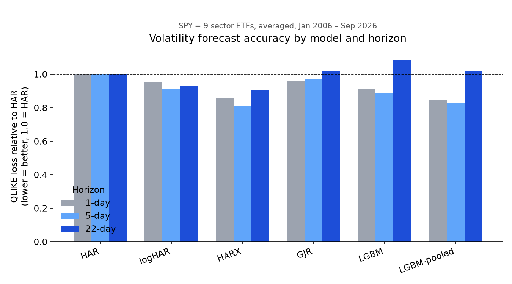
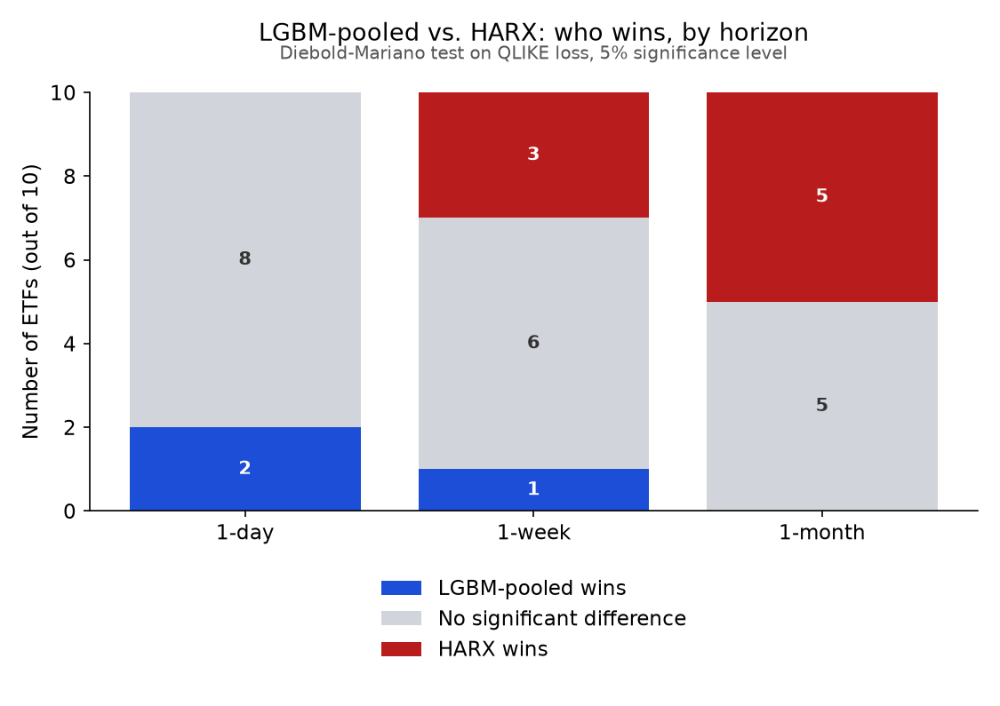
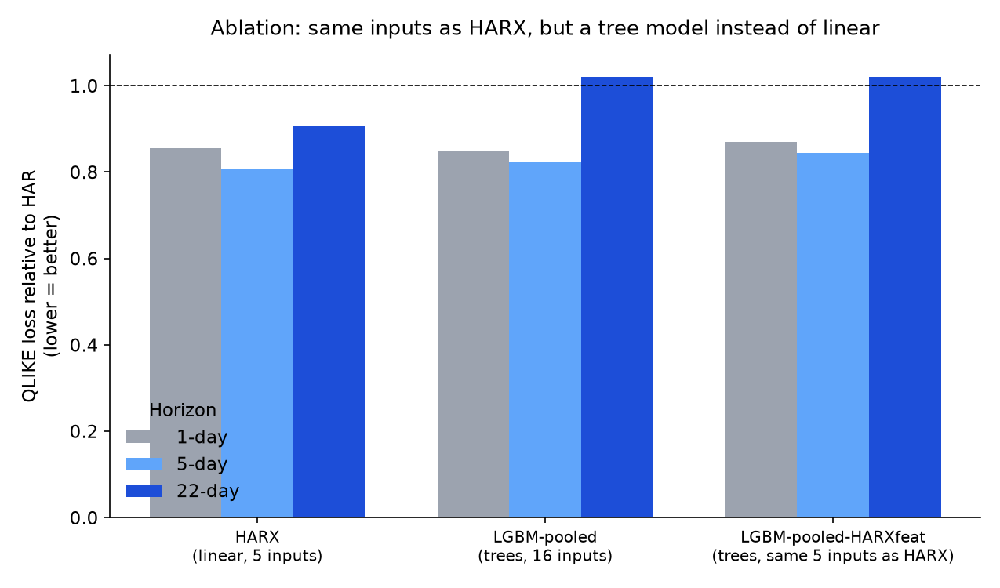

# Volatility forecasting: gradient boosting vs. HAR and GARCH

**Question.** Out of sample, does a gradient-boosted model forecast realized volatility of SPY and the SPDR sector ETFs better than the standard econometric benchmarks (HAR-RV, GARCH, GJR-GARCH, EWMA, and VIX for SPY), at 1-day, 1-week and 1-month horizons? If it does, where does the gain come from: which features, which horizons, which market regimes?

## Run it

```bash
pip install -r requirements.txt
python inspect_data.py              # step 0: coverage, validation drops, proxy vs VIX
python -m pytest -q                 # lookahead tests, must pass before trusting results
python run.py                       # SPY, horizons 1/5/22, monthly refits
python run.py --all --refit 63      # all ten ETFs, quarterly refits (faster)
python run.py --all --refit 63 --pool              # + one LightGBM trained on all ETFs together
python run.py --all --refit 63 --pool --pool-only   # same, skipping the slow per-ticker LGBM
python run.py --all --refit 63 --pool --pool-ablation --pool-only   # + the ablation (below)
```

`--pool-ablation` adds a row called `LGBM-pooled-HARXfeat`: pooled LightGBM restricted to
exactly HARX's five inputs (log_v_d, log_v_w, log_v_m, ret_neg, log_vix) — no lags, no VIX
change, no day-of-week. Same information as HARX, same pooled data as `LGBM-pooled`, but a
tree model instead of a linear one. This is step 2 of the plan: it isolates whether pooled
LightGBM's edge over HARX (where it has one) comes from the nonlinearity or from the extra
features/lags the full model gets that HARX doesn't. If `LGBM-pooled-HARXfeat` still beats
HARX, the edge is the nonlinearity. If it falls back to HARX's level, the edge was always
the extra information, and pooling only fixed how much data there was to learn it from.

`--pool` adds a row called `LGBM-pooled` to every ticker's results: one LightGBM model
trained on all requested tickers at once (ticker as a feature), instead of ten separate
models with ~700 training rows each. This is step 1 of the plan below — the main way
gradient boosting could still beat HARX. `--pool-only` skips the per-ticker LGBM fit,
which is the slowest model, when you only care about the pooled comparison.

Outputs land in `results/`: `metrics.csv` (one row per ticker x horizon x model), `forecasts_<TICKER>.csv` (every forecast next to the realized target), `run.log` (validation drops, floored days, GARCH fallbacks, timings).

## Design decisions

| Decision | Choice | Why |
|---|---|---|
| Volatility proxy | Squared overnight return + Rogers-Satchell range, from daily OHLC | True realized variance needs 5-minute data. Range estimators are far less noisy than squared returns and are free over 1999–today. Swap in intraday RV later if data becomes available. |
| Target | Mean daily variance over t+1 … t+h, h ∈ {1, 5, 22} | Matches how desks think: next day, next week, next month (≈ VIX horizon). |
| Scheme | Expanding window, re-estimated every 22 trading days, OOS from 2006 | OOS includes 2008, 2011, 2015, 2020, 2022, so results are not one calm regime. |
| Leakage control | Training row s used at origin p only if s + h ≤ p | Overlapping multi-day targets leak the future if you train on the last h rows. Tested in `tests/`. |
| Losses | MSE and QLIKE on variance | The two losses that rank forecasts correctly under a noisy proxy (Patton 2011). QLIKE punishes under-forecasting more, which is the costly error for risk and options. |
| Significance | Diebold-Mariano vs. HAR, Newey-West SE with lags ≥ h | Overlapping targets make loss differentials autocorrelated. |
| Calibration | Mincer-Zarnowitz regression (slope 1 = unbiased scale) | Separates "ranks well" from "right level". |
| Log models | Fit in logs, back-transform with Duan smearing | exp(E[log y]) is biased low; smearing corrects it. |

**Reading the output.** `MSE_rel` and `QLIKE_rel` are the model's average loss divided by HAR's: below 1 beats HAR. `DM_t_*` is computed on (model loss − HAR loss), so a **negative** t-stat means the model is better; |t| > 1.96 is significant at 5%.

## Models

- **HAR / logHAR**: OLS of the target on 1-, 5- and 22-day average variance (Corsi 2009). The benchmark to beat.
- **EWMA**: RiskMetrics, λ = 0.94. No estimation.
- **GARCH(1,1)-t, GJR-GARCH(1,1,1)-t**: close-to-close returns, via `arch`. GJR adds the leverage effect.
- **VIX** (SPY only): implied variance, flat over the horizon. Expect it to be biased high (variance risk premium).
- **HARX**: log-HAR plus negative returns and log VIX. A linear model with the key information LightGBM gets, so LGBM vs. HARX separates "nonlinearity helps" from "VIX helps". Run `python run.py --bench HARX` to test LGBM against it directly.
- **LGBM**: LightGBM on the log target with HAR lags, daily lags, signed returns, VIX level and change, implied-minus-realized spread, day of week.
- **LGBM-pooled**: the same LightGBM, but one model trained on all requested tickers at once (ticker as a categorical feature) instead of a separate fit per ticker. See Results below.
- **LGBM-pooled-HARXfeat**: LGBM-pooled restricted to exactly HARX's 5 inputs — the ablation that isolates nonlinearity from information. See Results below.

## Results

All ten tickers (SPY + 9 SPDR sector ETFs), forecasts made from January 2006 to September
2026 (~5,200 trading days per horizon), refit quarterly. Full numbers in
`results/raw_runs/` and `results/summary_table*.csv`; charts below are generated from
that data, not hand-drawn.

**1. Does gradient boosting beat the standard benchmarks?** Averaged across all ten
tickers, QLIKE loss relative to HAR (lower is better, 1.000 = HAR):

| Model | 1-day | 1-week | 1-month |
|---|---|---|---|
| HAR | 1.000 | 1.000 | 1.000 |
| logHAR | 0.955 | 0.911 | 0.930 |
| GJR-GARCH | 0.961 | 0.970 | 1.020 |
| **HARX** (log-HAR + leverage + VIX) | **0.855** | **0.808** | **0.906** |
| LightGBM, per ticker | 0.914 | 0.890 | 1.083 |
| LightGBM, pooled across tickers | 0.849 | 0.825 | 1.020 |



Per-ticker LightGBM loses to HARX at every horizon — about 700 training rows per ticker
isn't enough. Pooling all ten tickers into one LightGBM model (ticker as a feature, ~10x
the data) closes most of that gap and pulls slightly ahead of HARX at 1 day, but HARX
stays clearly ahead at 1 week and 1 month.

**2. Is "slightly ahead at 1 day" real, or noise?** Diebold-Mariano test, pooled LightGBM
vs. HARX, 5% significance level, per ticker:



At 1 day, pooled LightGBM is statistically indistinguishable from HARX on 8 of 10
tickers, and significantly better on 2 (XLK, XLP) — no ticker favors HARX. At 1 week the
balance starts shifting (3 tickers favor HARX, 1 favors LightGBM). At 1 month HARX wins
outright on half the tickers and loses on none. So pooling narrowed the gap, but mainly
at the shortest horizon.

**3. Where does pooled LightGBM's edge come from — the model, or the information?**
HARX sees 5 inputs; the full LightGBM sees 16 (extra lags, VIX change, day of week). The
ablation gives LightGBM exactly HARX's 5 inputs and nothing else — same information,
same pooled data, but a tree model instead of a linear one:

| Model | 1-day | 1-week | 1-month |
|---|---|---|---|
| HARX (linear, 5 inputs) | 0.855 | 0.808 | 0.906 |
| LGBM-pooled (trees, 16 inputs) | 0.849 | 0.825 | 1.020 |
| LGBM-pooled-HARXfeat (trees, same 5 inputs as HARX) | 0.869 | 0.845 | 1.021 |



Given identical inputs, the tree model is **worse than HARX at every horizon, on every
one of the 10 tickers at 5 and 22 days**, and worse than its own full-feature version in
29 of 30 ticker-horizon cells. The edge pooled LightGBM has over HARX is not coming from
nonlinearity — it's coming from the extra features and lags that only the full model
gets. Strip those away and HARX's linear fit handles the same information better than
the trees do.

**Conclusion.** Per-ticker LightGBM underperforms a correctly-specified linear model —
it's data-starved. Pooling data across tickers fixes most of that at the 1-day horizon,
where pooled LightGBM roughly matches or slightly beats HARX; it does not fix it at 1
week or 1 month, where HARX wins outright on half the tickers. The ablation shows this
1-day gain is not the model being "smarter": fed identical inputs, HARX's linear fit
beats LightGBM's trees everywhere. The practical takeaway for a desk: gradient boosting
is worth it, if at all, only (a) with enough pooled data and (b) at the shortest
horizon, and only because it can absorb more raw features than a hand-built linear
model — not because trees extract more from the same features. A simple, well-specified
linear model is the safer default past a few days out.

## Known limitations (state these before an interviewer does)

- The proxy is range-based, not intraday RV. Forecast rankings should be robust (Patton losses), absolute loss levels less so.
- GARCH models close-to-close variance while the proxy includes the full intraday range; the Mincer-Zarnowitz slope will show any level mismatch.
- Early sector-ETF history (1999–2002) is thinly traded: more zero-range days (see `run.log`). August 24, 2015 and May 6, 2010 contain ETF dislocation prints that look like extreme volatility.
- LightGBM hyperparameters are fixed and conservative in this first pass. Smearing uses in-sample residuals, which understates the correction for a flexible model.

## Plan

| Days | Work | Done when |
|---|---|---|
| 1 | Run `inspect_data.py`, read `run.log`, decide on 2015/2010 dislocation days | Written note on data decisions |
| 2–3 | SPY baseline table (this repo), sanity-check HAR coefficients against Corsi | HAR betas positive, sum < 1, results stable |
| 4–5 | All ten ETFs; pooled LightGBM across ETFs (`--pool`, done — see above) | Pooled vs. per-ticker comparison |
| 6 | Ablation: pooled LightGBM on HARX's inputs only (`--pool-ablation`, done — see above) | Nonlinearity vs. information |
| 7 | Feature importance (SHAP), performance by regime (VIX terciles, 2008, 2020) | Answer to "where does the gain come from" |
| 8–9 | Economic value: vol-targeting SPY at 10% using each forecast; SPY VIX-vs-forecast spread as a vol risk premium signal | Sharpe and turnover per model |
| 10 | README results section, 3 charts, one-paragraph conclusion (done — see Results above) | Project linkable from CV |

## References

- Corsi (2009), A Simple Approximate Long-Memory Model of Realized Volatility, *Journal of Financial Econometrics*.
- Patton (2011), Volatility Forecast Comparison Using Imperfect Volatility Proxies, *Journal of Econometrics*.
- Rogers & Satchell (1991), Estimating Variance from High, Low and Closing Prices, *Annals of Applied Probability*.
- Glosten, Jagannathan & Runkle (1993), *Journal of Finance* (GJR-GARCH).
- Diebold & Mariano (1995), Comparing Predictive Accuracy, *Journal of Business & Economic Statistics*.
